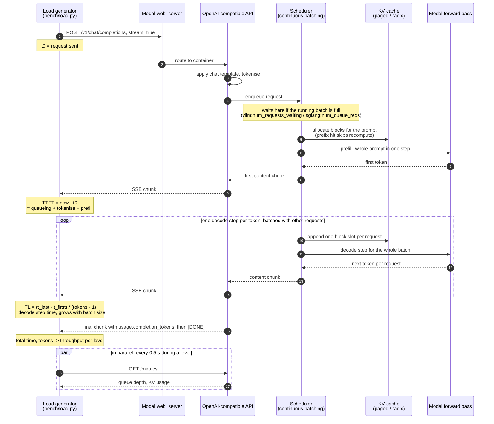
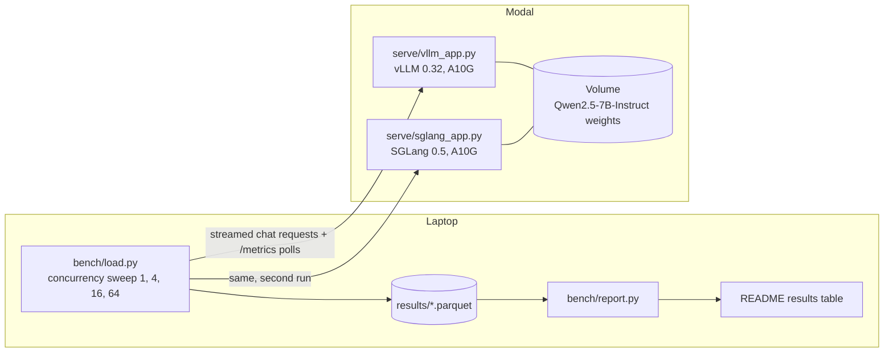

# Architecture and motivation

This document explains what the benchmark measures, where in the serving pipeline each number comes from, and why vLLM and SGLang are the two servers worth comparing. The results table lives in the [README](../README.md).

## What a request goes through

Both servers follow the same high-level pipeline. The differences that matter for latency are inside the scheduler and the KV cache, which is why the benchmark holds everything else constant: same model, same GPU, same context length, same prompts, same client.

### Where each metric comes from

| Metric | Measured | Dominated by | What moves it |
|---|---|---|---|
| Time to first token (TTFT) | Client, first content chunk minus send time | Queueing plus prefill | Prompt length, how full the running batch is, prefix cache hits, chunked prefill |
| Inter-token latency (ITL) | Client, mean gap between first and last chunk | Decode step time | Batch size, KV-cache reads per step, attention kernel efficiency |
| Throughput | Sum of completion tokens over wall time of the level | Decode batch size | How many sequences the KV cache can hold, scheduler overhead |
| Queue depth | Server `/metrics`, sampled | Admission control | Requests arriving faster than the KV cache frees blocks |
| KV usage | Server `/metrics`, sampled | Memory pressure | Sequences in flight times their context length, block size |

TTFT and ITL pull in opposite directions under load. A bigger running batch raises throughput and ITL together, while anything that cannot be admitted waits in the queue and shows up as TTFT. The knee in the throughput curve is where KV blocks run out and the queue starts to grow.

Latency is measured on the client on purpose. Server-side histograms exclude Modal's ingress and the network, and a user of the system never sees those excluded.

## Benchmark topology

Each server runs in its own Modal app on an identical GPU and reads the same cached weights. The two benchmark runs are sequential, so they never share a GPU. Modal's `scaledown_window` keeps the container warm between concurrency levels, which avoids cold starts polluting TTFT.

## Why vLLM and SGLang

Both are production inference engines built on the two ideas that made LLM serving efficient:

- **Continuous batching.** New requests join the running batch at any decode step instead of waiting for the batch to drain. This is what lets throughput scale with concurrency.
- **Paged KV cache.** The attention cache is stored in fixed-size blocks allocated on demand, so memory is not reserved for the maximum context length up front. This is what sets how many sequences fit on one GPU.

They diverge in the layer above:

| | vLLM | SGLang |
|---|---|---|
| KV cache design | PagedAttention with automatic prefix caching by block hash | RadixAttention: a radix tree over token prefixes, so any shared prefix is reused across requests |
| Scheduler | V1 engine, chunked prefill mixes prefill and decode in one step | Zero-overhead scheduler that overlaps CPU scheduling with the GPU step |
| Structured output | Guided decoding via pluggable grammar backends | Constrained decoding is a core feature, with a frontend language for multi-call programs |
| Coverage | Broadest model, hardware and quantisation support | Narrower, optimised for the common architectures |

The practical consequence: SGLang should win when many requests share a long prefix, such as a system prompt or few-shot examples, because the radix tree turns that prefill into a cache hit. vLLM should hold its own on unshared prompts and is the safer default when the model or GPU is unusual. Whether that holds on this hardware is what the benchmark checks.

## Choosing a server

To be filled in from the results table once both runs have completed. Each recommendation below will cite a row in the README.

- Many short chats with a shared system prompt: pending
- Long-context single user: pending
- JSON-constrained output: pending
- Highest throughput at the cost of ITL: pending
